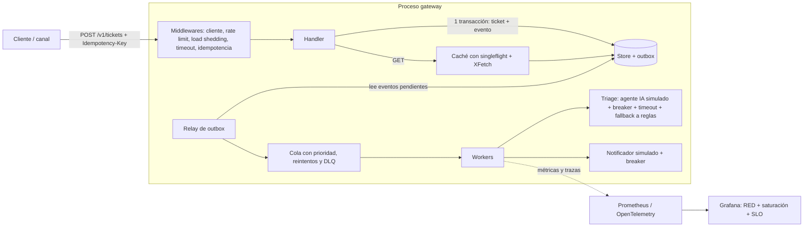

# cortex9-crm-ticket-gateway-go

Gateway de tickets de atención al cliente escrito en Go, pensado para **alto tráfico**: recibe tickets por HTTP, los guarda de forma transaccional, los clasifica con un **agente de IA simulado** (con breaker, timeout y fallback a reglas) y notifica a un servicio externo sin que una falla aguas abajo afecte a la API.

Es un proyecto de estudio y portfolio. Todo corre en memoria y en un solo proceso: no hay base de datos real, ni cola real, ni LLM real. Lo que sí es real es la ingeniería alrededor: los patrones, los tests (incluido el detector de carreras), las métricas Prometheus, el tablero de Grafana, las reglas de SLO y una **prueba de carga medida y reproducible**.

> Ref: CX9-6171 · Licencia Apache-2.0

## Índice

1. [Qué problema resuelve](#qué-problema-resuelve)
2. [Arquitectura en una imagen](#arquitectura-en-una-imagen)
3. [Cómo correrlo](#cómo-correrlo)
4. [Resultados medidos](#resultados-medidos)
5. [Decisiones de diseño, una por una](#decisiones-de-diseño-una-por-una)
6. [Observabilidad: métricas, tablero y SLO](#observabilidad-métricas-tablero-y-slo)
7. [Tests y cobertura](#tests-y-cobertura)
8. [Qué NO es este proyecto (limitaciones honestas)](#qué-no-es-este-proyecto-limitaciones-honestas)
9. [Documentación relacionada](#documentación-relacionada)

## Qué problema resuelve

En un área de atención al cliente de un e-commerce grande, los tickets llegan por chat, mail, teléfono y app. En días pico (Hot Sale, Black Friday) el volumen se multiplica, y justo ahí las dependencias (base de datos, servicio de notificaciones, modelo de IA) se ponen lentas o fallan. El servicio tiene que:

- **No perder tickets ni duplicarlos**, aunque el cliente reintente o se corte la conexión.
- **Responder rápido siempre**, aunque el agente de IA o las notificaciones estén caídos.
- **Protegerse de un cliente abusivo** sin castigar al resto.
- **Degradarse con elegancia** cuando está saturado: rechazar rápido una parte en lugar de que todo se vuelva lento.
- **Ser observable**: saber en todo momento cuánto tráfico hay, cuántos errores, qué latencia y qué parte del sistema está sufriendo.

## Arquitectura en una imagen



La idea central: **la request HTTP solo hace lo imprescindible** (validar, guardar ticket y evento en una transacción, responder 201). Todo lo lento o frágil (IA, notificaciones) pasa después, en segundo plano, por una cola con reintentos. Por eso, en la prueba de carga, la latencia de la API es la misma con las dependencias sanas que con las dependencias fallando el 50 % de las veces.

Más diagramas en [`docs/conceptos/`](docs/conceptos/).

## Cómo correrlo

Requiere Go (la versión exacta está en `go.mod`).

```bash
go test -race ./...              # todos los tests con detector de carreras
./scripts/coverage.sh            # cobertura -> results/coverage.txt
go run ./cmd/loadtest            # prueba de carga -> results/LOADTEST.md y results/loadtest.json
go run ./cmd/gateway             # levanta el servicio en :8080 (API) y :8081 (admin/métricas)
```

Ejemplo de uso con el servicio levantado:

```bash
CLAVE="pedido-123-reclamo"   # una clave por intención, no por request
curl -s -X POST localhost:8080/v1/tickets \
  -H 'X-Client-ID: tienda-1' -H "Idempotency-Key: $CLAVE" \
  -H 'Content-Type: application/json' \
  -d '{"customer_id":"c-1","subject":"No llegó mi pedido","body":"Pagué y no llegó","channel":"chat"}'
curl -s localhost:8081/metrics | grep http_requests_total
curl -s localhost:8081/admin/stats
```

Toda la configuración se puede cambiar por variables de entorno (`RATE_PER_SEC`, `DB_LATENCY`, `NOTIFY_ERROR_RATE`, `TRACE_EXPORTER=stdout|otlp`, etc.; ver `internal/app/config.go`).

La carpeta `deploy/` tiene la configuración de Prometheus (`prometheus.yml` y `rules/slo.yml`), el aprovisionamiento de Grafana (datasource y tablero `crm-ticket-gateway.json`) y un collector de OpenTelemetry mínimo. **No incluí docker-compose** porque no lo pude ejecutar en el entorno donde construí esto, y prefiero no publicar algo sin haberlo probado. Lo que sí está verificado por un test (`TestDashboardAndRulesUseExistingMetrics`) es que **cada métrica que usan el tablero y las alertas existe de verdad** en el servicio: así un renombre no deja el tablero en blanco sin que nadie se entere.

## Resultados medidos

Todo sale de `go run ./cmd/loadtest` (semilla fija 20261112, 8 s por escenario, 3 repeticiones, el primer segundo se descarta como calentamiento). El detalle completo está en [`results/LOADTEST.md`](results/LOADTEST.md) y los datos crudos en [`results/loadtest.json`](results/loadtest.json).

**Entorno:** linux/amd64, Go 1.27.3, 8 CPU, máquina compartida. El generador de carga y el servidor corren en el mismo proceso y la misma máquina (loopback). Los números sirven para **comparar escenarios entre sí**, no como capacidad de producción.

**Cómo se mide:** carga de *lazo abierto*. Las requests se programan a tasa fija y la latencia se cuenta desde el momento en que la request *debía* salir. Si el servidor se traba, el generador no se frena, y la demora aparece en los percentiles. Esto evita la "omisión coordinada", el error clásico de las herramientas que esperan una respuesta antes de mandar la siguiente.

| Escenario | Qué simula | rps logrado | p50 | p99 (3 repeticiones) | Resultado clave |
|---|---|---|---|---|---|
| `baseline` | 2000 rps, 30 % POST / 70 % GET, 50 tenants, 10 % de POST repetidos con la misma clave | ~1999.5 | ~1.6 ms | 4.20 / 4.23 / 4.22 ms | 4306 claves únicas aceptadas = 4306 tickets guardados (cero duplicados); 0 errores 5xx |
| `downstream_chaos` | igual, pero el notificador y el agente IA fallan el 50 % | ~1999.4 | ~1.3 ms | 4.30 / 4.43 / 4.28 ms | La API no se enteró: 0 errores 5xx. El breaker cortó las llamadas al notificador: **85 llamadas en lugar de 4306** |
| `noisy_neighbor` | 1000 rps normales + un tenant abusivo a 1500 rps, límite 200 rps por tenant | ~2499.5 | ~0.9 ms | 4.11 / **171.0** / 4.08 ms | El abusivo recibió 429 en el 86.7 % de sus requests; los tenants normales, **0 %** |

Lo que muestran y lo que no:

- **El p99 de la API no cambia cuando las dependencias fallan** (4.2 ms frente a 4.3 ms). Es la consecuencia directa de mandar la IA y las notificaciones a una cola.
- **Idempotencia bajo carga:** los POST repetidos devolvieron la misma respuesta y nunca crearon un segundo ticket. Hubo entre 8 y 11 respuestas **409** por corrida: son POST con la misma clave mientras la primera seguía en curso. Es el comportamiento elegido (ver [ADR-0002](docs/adr/0002-idempotency-key-con-lease.md)).
- **La repetición 2 de `noisy_neighbor` tuvo un p99 de 171 ms**, contra 4.1 ms de las otras dos. No lo escondí: la máquina era compartida y no lo pude atribuir a nada del servicio. Por eso se corren 3 repeticiones, y por eso el p99 de una sola corrida no alcanza para sacar conclusiones.
- **Un problema real que encontró la prueba:** con las dependencias fallando, casi todos los eventos de notificación (4267 a 4268 de 4306) terminaron en la **DLQ**. El breaker abierto hace que cada intento falle al instante, y con el backoff corto de la prueba (máximo 200 ms) los 6 intentos se agotan en alrededor de un segundo. No se pierde nada (la DLQ tiene *redrive*), pero en producción conviene **pausar el consumo mientras el breaker está abierto** en lugar de quemar intentos. Está anotado como siguiente paso en el [ADR-0003](docs/adr/0003-ia-fuera-del-camino-critico.md).
- **El triage con IA:** con dependencias sanas, el agente clasificó 3806 tickets y 500 cayeron al fallback por baja confianza (umbral 0.6). Con el 50 % de fallas, entre 3996 y 4231 se resolvieron por "breaker abierto" con reglas, sin esperar al timeout. Ningún ticket quedó sin clasificar.

## Decisiones de diseño, una por una

Cada decisión responde una pregunta concreta. Las más importantes tienen su ADR en [`docs/adr/`](docs/adr/).

### 1. Go y la biblioteca estándar para HTTP

`net/http` con el router de Go 1.22+ (`"POST /v1/tickets"`, `r.PathValue("id")`) alcanza y sobra. Menos dependencias significa menos superficie de ataque y menos cosas que actualizar. Las goroutines hacen barato atender miles de conexiones concurrentes sin pensar en hilos. Las únicas dependencias externas son Prometheus y OpenTelemetry.

### 2. La request hace lo mínimo; lo frágil va a una cola

El handler valida, guarda el ticket **y** el evento `ticket.created` en la **misma transacción** (patrón *transactional outbox*) y responde. Un relay lee la outbox y publica en la cola; los workers hacen el triage y la notificación. Si guardara el ticket y después publicara en la cola por separado, un crash entre los dos pasos dejaría un ticket sin evento. Con la outbox, o se guardan los dos o ninguno. Ver [ADR-0001](docs/adr/0001-transactional-outbox.md) y [`docs/conceptos/outbox-y-cola.md`](docs/conceptos/outbox-y-cola.md).

La entrega resultante es **al menos una vez**: un evento puede llegar dos veces. Por eso el consumidor es idempotente: la cola deduplica por ID de evento y el triage no vuelve a clasificar un ticket ya clasificado.

### 3. Idempotency-Key obligatoria en POST y PATCH

Las redes fallan: el cliente manda el POST, el servidor crea el ticket, la respuesta se pierde y el cliente reintenta. Sin protección, eso son dos tickets. El cliente manda una clave única por operación; la primera vez se ejecuta y se guarda la respuesta; las siguientes reciben **la misma respuesta byte a byte** sin re-ejecutar nada. Si llega la misma clave con otro cuerpo, 422; si llega mientras la primera sigue en curso, 409 (o espera, si se configura). Las entradas en curso tienen un *lease* para que una caída no bloquee la clave para siempre, y un *token* de dueño para que un `Complete` tardío no pise a otro. Este último bug lo encontró un test basado en propiedades que compara contra un modelo simple. Ver [ADR-0002](docs/adr/0002-idempotency-key-con-lease.md) y [`docs/conceptos/idempotencia.md`](docs/conceptos/idempotencia.md).

### 4. Rate limit por cliente (token bucket) antes que todo

Cada cliente tiene un balde de `Burst` tokens que se rellena a `Rate` por segundo. Permite ráfagas cortas y limita el promedio. El relleno es perezoso (se calcula al llegar la request; no hay una goroutine por cliente), el mapa está dividido en *shards* para reducir la contención y un barrido borra los baldes inactivos. Responde 429 con `Retry-After` y los encabezados `RateLimit-*`. Va primero en la cadena porque es lo más barato y lo que más rechaza.

### 5. Load shedding adaptativo (AIMD) además del rate limit

El rate limit protege de **un** cliente; no protege si **todos** juntos superan la capacidad o si la base se pone lenta. Por la ley de Little (en vuelo = tasa × latencia), cuando la latencia sube, la concurrencia crece. El limitador AIMD sube el límite de concurrencia de a poco mientras la latencia está bajo el objetivo y lo recorta un 10 % cuando se pasa, igual que el control de congestión de TCP. Lo que excede se rechaza al instante con 503 y `Retry-After`. Es mejor rechazar rápido el 10 % que responder lento al 100 %. Ver [`docs/conceptos/proteccion-de-carga.md`](docs/conceptos/proteccion-de-carga.md).

### 6. Caché con singleflight y expiración temprana probabilística

Las lecturas por ID pasan por una caché con TTL. Dos problemas clásicos:

- **Estampida (*thundering herd*):** vence una entrada popular y mil requests van a la base a la vez. Lo resuelve **singleflight**: una sola carga por clave; los demás esperan su resultado.
- **Vencimiento sincronizado:** aun con singleflight, todos esperan esa carga. **XFetch** (Vattani y otros, VLDB 2015) hace que cada lectura decida, con una probabilidad que crece al acercarse el vencimiento, refrescar en segundo plano antes de que venza. El que lee recibe el valor vigente.

Las escrituras invalidan la entrada (*invalidate-on-write*). En la prueba de carga, la tasa de aciertos fue del 65.7 % al 70.2 %, con lecturas de tickets recién creados. Ver [`docs/conceptos/cache.md`](docs/conceptos/cache.md).

### 7. Circuit breaker y fallback para el agente de IA y el notificador

Un breaker por dependencia, con una ventana deslizante de 10 s dividida en 10 buckets. Si en la ventana hay al menos 20 llamadas y falla la mitad o más, se **abre**: durante 2 s falla al instante sin llamar a la dependencia. Después pasa a **semiabierto** y deja pasar 3 pruebas; si salen bien, se cierra. El triage, además, tiene timeout de 500 ms, valida la salida del agente (categoría y prioridad conocidas) y un umbral de confianza. Si algo falla, **cae a reglas por palabras clave, que nunca fallan**. La IA es una mejora, no un punto único de falla. Ver [ADR-0003](docs/adr/0003-ia-fuera-del-camino-critico.md) y [`docs/conceptos/resiliencia.md`](docs/conceptos/resiliencia.md).

### 8. Cola con prioridad por SLA, reintentos con *full jitter* y DLQ

Los tickets P1 se procesan antes que los P4, pero 1 de cada 8 mensajes se toma por antigüedad para que los P4 no esperen para siempre (anti-*starvation*). Los reintentos usan backoff exponencial con *full jitter* (un tiempo al azar entre 0 y el tope) para que miles de reintentos no lleguen sincronizados. Después de `MaxAttempts` o ante un error permanente (payload inválido), el mensaje va a la **DLQ**, que se puede reprocesar con `POST /admin/dlq/redrive`. La capacidad es acotada: si se llena, el relay deja el evento en la outbox y reintenta (*backpressure*).

### 9. Concurrencia optimista y paginación keyset

`PATCH /v1/tickets/{id}/status` acepta `If-Match` con la versión que el cliente leyó (el `ETag`, por ejemplo `"v3"`). Si otro agente cambió el ticket antes, responde 412 y nadie pisa el cambio de otro sin enterarse. Es opcional para no romper clientes viejos; un trade-off que explico en la entrevista. El listado pagina por cursor (*keyset*: "dame los siguientes después de este ID") en lugar de `OFFSET`, que se vuelve lento con muchas filas y salta o repite elementos si se insertan filas mientras se pagina. Hay un test que lo verifica insertando durante la paginación.

### 10. Apagado ordenado con presupuesto por etapas

Al recibir SIGTERM (por ejemplo, Kubernetes al hacer un despliegue): (1) `/readyz` pasa a 503 para que el balanceador deje de mandar tráfico; (2) se esperan las requests en curso; (3) el relay publica lo que quedó en la outbox; (4) la cola drena, reintentos incluidos; (5) se vacían las trazas y al final se apaga el puerto de métricas. Cada etapa usa una fracción del tiempo restante. Es **idempotente**: si llega una segunda señal, devuelve el mismo reporte. Hubo un bug real: el segundo `Shutdown` cerraba un canal ya cerrado y entraba en pánico. Lo detectó un test y se resolvió con `sync.Once`.

### 11. Puerto de administración separado

`/metrics`, `/admin/chaos`, `/admin/dlq` y `pprof` van en otro puerto (8081) que nunca se expone a internet. `PUT /admin/chaos` cambia en caliente la latencia y la tasa de error de las dependencias simuladas, lo que permite ensayar incidentes.

## Observabilidad: métricas, tablero y SLO

- **Método RED** (*Rate, Errors, Duration*) por ruta: `http_requests_total{route,method,code}` y el histograma `http_request_duration_seconds`. Los *buckets* incluyen exactamente 50, 100 y 250 ms, que son los umbrales de los SLO, para que "porcentaje de requests bajo 250 ms" se calcule sin interpolar.
- **Saturación de cada patrón:** profundidad de la cola por estado, pendientes y antigüedad de la outbox, estado de cada breaker, límite AIMD actual, conexiones de base en uso, aciertos de caché y resultados de idempotencia.
- **Trazas OpenTelemetry** con propagación W3C `traceparent`: el *trace id* que entra en el POST viaja dentro del evento por la outbox y la cola, así el span del worker queda en la misma traza que el de la request. Lo verifica un test.
- **SLO** en `deploy/prometheus/rules/slo.yml`: 99.9 % de requests sin 5xx y 99 % de los POST bajo 250 ms, con alertas por *burn rate* en varias ventanas (rápida 14.4× en 1 h y 5 min; lenta 6× en 6 h), como propone el *SRE Workbook* de Google. Ver [`docs/conceptos/observabilidad-y-slo.md`](docs/conceptos/observabilidad-y-slo.md).
- **Grafana:** `deploy/grafana/dashboards/crm-ticket-gateway.json` con 12 paneles. El aviso menciona Datadog o Grafana; las mismas métricas se pueden mandar a Datadog con su agente leyendo `/metrics` en formato OpenMetrics, sin cambiar el código.

## Tests y cobertura

- 65 funciones de test en 13 paquetes, todas con `-race` en CI.
- **Cobertura total del código de `internal/`: 97.0 % a 97.1 %** según la corrida (con `-coverpkg`, para que los tests de integración cuenten para `api` y `observability`). Varía una décima porque algunos caminos de la cola dependen de tiempos. El detalle por paquete está en [`results/coverage.txt`](results/coverage.txt).
- Hay tests de integración HTTP de punta a punta, de caos (la API cumple su SLO mientras las dependencias fallan), de apagado ordenado, de propagación de trazas, basados en propiedades (idempotencia contra un modelo) y de concurrencia (rate limit, breaker, AIMD y store bajo goroutines concurrentes).
- `staticcheck`, `go vet` y `gofmt` en CI.

Bugs reales que encontraron los tests mientras lo construía:

1. **Carrera de datos en la cola** (la detectó `-race`): al reprogramar un reintento se copiaba el mensaje *después* de soltar el lock, y otro worker ya podía estar modificándolo. Se resolvió copiándolo bajo el lock.
2. **Doble cierre de canal en el apagado:** se resolvió con `sync.Once`.
3. **Pisada de lease en idempotencia:** un `Complete` tardío podía cerrar la entrada de otro dueño. Se resolvió con un token de dueño.

## Qué NO es este proyecto (limitaciones honestas)

- **No hay base de datos ni cola reales.** El store en memoria imita la semántica (transacción atómica, versión optimista, pool de conexiones con latencia) pero no la durabilidad. Un reinicio pierde todo. En producción: Postgres o MySQL con la tabla outbox, y Kafka, SQS o la cola interna de la empresa.
- **El agente de IA es simulado y determinista** (puntajes por palabra clave). No hay LLM ni red. Lo que se muestra es la ingeniería alrededor de un agente real.
- **Un solo proceso.** El rate limit y la idempotencia viven en memoria; con varias réplicas harían falta en Redis (`SET NX PX`) o en una tabla con clave primaria, y el rate limit pasaría a ser aproximado o centralizado.
- **La prueba de carga corre en la misma máquina que el servidor.** Mide diferencias entre escenarios, no capacidad absoluta.
- **Sin autenticación:** `X-Client-ID` representa al cliente que en producción saldría de un token OAuth validado.
- **No probé el tablero en un Grafana levantado**: validé que el JSON es válido y que todas las métricas existen.

## Documentación relacionada

- [`docs/conceptos/`](docs/conceptos/): cada concepto explicado a fondo con diagramas.
- [`docs/adr/`](docs/adr/): decisiones de arquitectura con contexto, alternativas y consecuencias.
- [`INTERVIEW.md`](INTERVIEW.md): preguntas difíciles de entrevista sobre este proyecto, con respuestas modelo y trade-offs.
- [`results/`](results/): números medidos.
