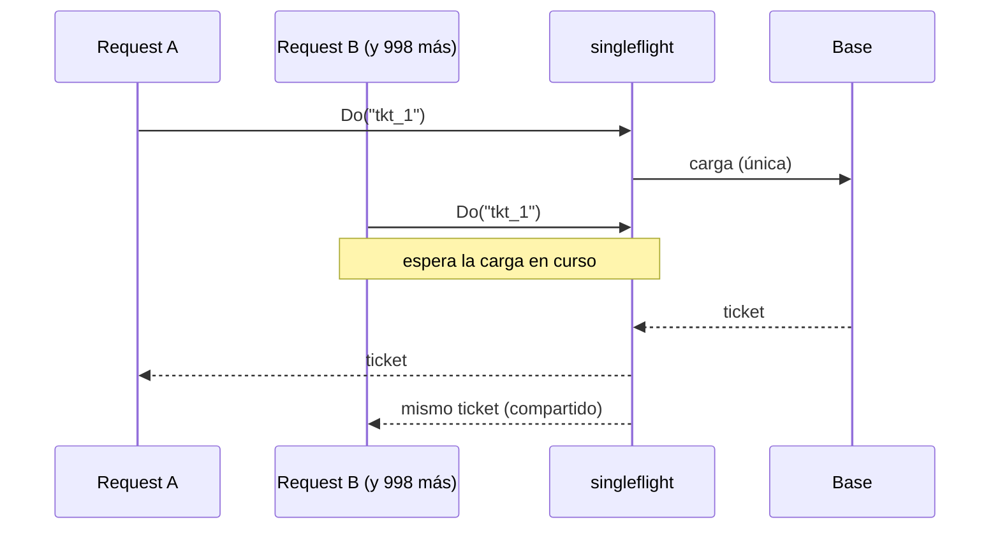

# Caché, singleflight y XFetch

## Read-through con TTL

`GET /v1/tickets/{id}` pregunta a la caché. Si no está o venció, la caché llama a la función de carga (la base), guarda el resultado por `TTL` (5 s) y lo devuelve. Las escrituras **invalidan** la entrada (*invalidate-on-write*), así el siguiente GET lee el valor nuevo.

## Problema 1: estampida (*thundering herd*)

Una entrada popular vence y mil requests llegan en el mismo milisegundo. Las mil van a la base: un pico que puede tumbarla justo cuando hay más tráfico.

**Solución: singleflight.** Para cada clave, una sola carga en curso; los demás esperan su resultado.



La carga compartida usa su propio contexto con timeout: si el primer cliente cancela, no se cancela la carga que esperan los demás.

## Problema 2: todos esperan esa única carga

Con singleflight, la base recibe una sola consulta, pero los mil esperan esa latencia. **XFetch** (Vattani, Chierichetti y Lowenstein, VLDB 2015) refresca **antes** de que venza:

```
refrescar si  ahora − delta × beta × ln(rand()) ≥ vencimiento
```

- `delta`: cuánto tardó la última carga (lo caro se refresca antes).
- `beta`: agresividad (1 por defecto).
- `−ln(rand())` es una variable exponencial: la probabilidad de refrescar es casi cero lejos del vencimiento y crece al acercarse.

El refresh temprano corre en segundo plano y quien lee recibe el valor vigente, que todavía no venció. Lo verifican `TestXFetchProbabilityGrowsNearExpiry` y `TestEarlyRefreshServesStaleValueAndRefreshesOnce`.

## Tamaño acotado

La caché tiene un máximo de entradas: un ataque que pida millones de IDs distintos no puede agotar la memoria.

## Medido

Tasa de aciertos entre 65.7 % y 70.2 % en la prueba de carga. Los GET apuntan a uno de los últimos 50 tickets del tenant, y cada POST nuevo genera un ID que todavía no está en caché.

## Consistencia: lo que se acepta

Con TTL e invalidación local, una réplica podría servir un valor de hasta 5 s de antigüedad si otra réplica escribió. Para el estado de un ticket es aceptable; para un saldo no lo sería.
