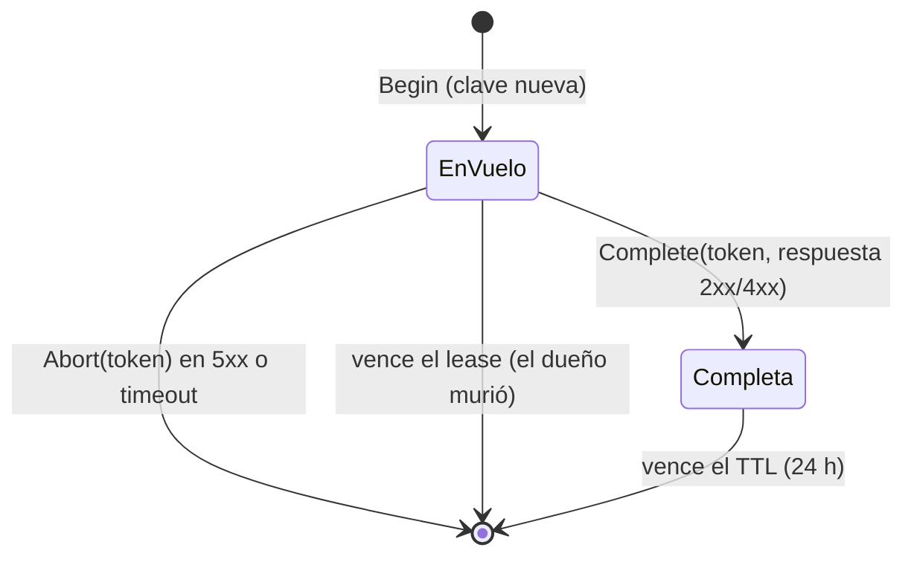
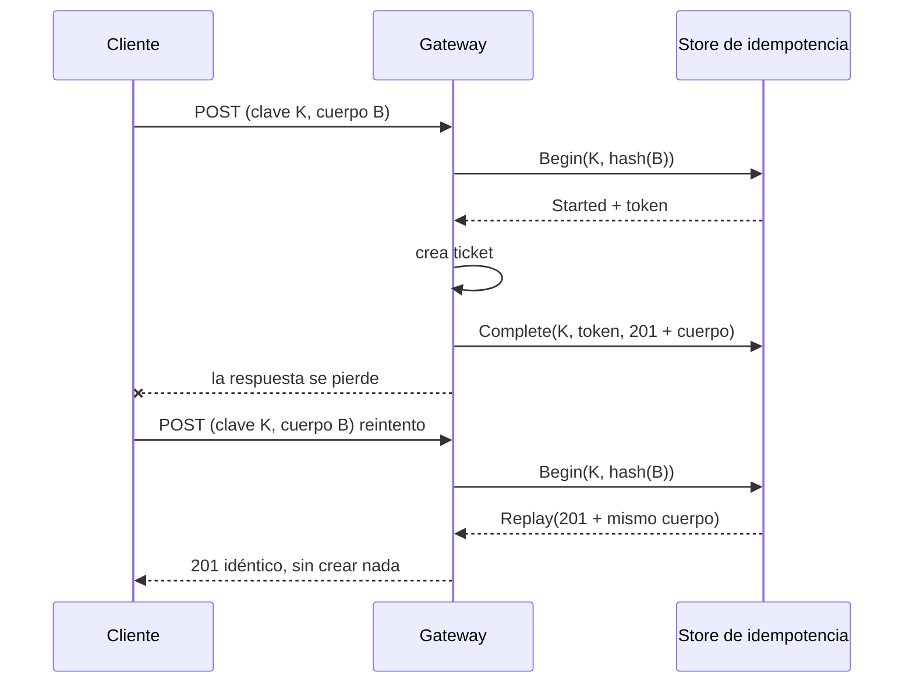

# Idempotencia e Idempotency-Key

## La idea en una frase

Una operación es **idempotente** si hacerla una vez o diez veces deja el sistema igual. `GET` y `PUT` lo son por definición en HTTP; `POST` no: cada POST puede crear algo nuevo.

## Por qué importa

Un cliente manda `POST /v1/tickets`. El servidor crea el ticket, pero la respuesta se pierde (se cortó el wifi o venció un timeout del balanceador). El cliente no sabe si se creó y reintenta. Sin protección, hay **dos tickets** para el mismo reclamo. En pagos, esto sería un doble cobro.

## Cómo funciona aquí

El cliente genera una clave única por *intención* (no por request) y la manda en `Idempotency-Key`. El servidor guarda, para cada clave, una huella del contenido (SHA-256 de método, ruta y cuerpo) y la respuesta.

Casos:

| Situación | Respuesta |
|---|---|
| Clave nueva | Se ejecuta y se guarda la respuesta |
| Misma clave y mismo cuerpo, ya terminada | La respuesta guardada, byte a byte (*replay*) |
| Misma clave con otro cuerpo | 422: el cliente reutilizó la clave por error |
| Misma clave, la primera sigue en curso | 409, o esperar hasta `IDEMPOTENCY_WAIT` |
| La primera terminó en 5xx, timeout, 409, 412 o 429 | No se guarda (*Abort*): el cliente puede reintentar con la misma clave |

## Dos detalles finos

1. **Lease:** si el proceso que tomó la clave se cae antes de terminar, la clave no puede quedar bloqueada para siempre. Las entradas en curso vencen solas a los 30 s.
2. **Token de dueño:** supongamos que A toma la clave, se demora más que el lease, la clave vence y B la toma. Si después A llama a `Complete`, no debe pisar a B. Por eso `Complete` y `Abort` exigen el token que devolvió `Begin`. Este bug lo encontró `TestPropertyMatchesModel`, que ejecuta miles de secuencias aleatorias de operaciones y compara contra un modelo de referencia muy simple.

## Por qué el middleware de idempotencia va al final de la cadena

Si estuviera antes del rate limit, guardaría un 429 como "la respuesta" de esa clave y el cliente no podría reintentar nunca. Queda lo más cerca posible del efecto (el handler).

## En producción

El store en memoria se reemplaza por Redis (`SET K valor NX PX 30000` para tomar la clave de forma atómica) o por una tabla con la clave como *primary key* dentro de la misma transacción que el efecto. Esta segunda opción es la más fuerte: o se guardan el ticket y la clave, o ninguno.

## Medido

En la prueba de carga, el 10 % de los POST reutilizaban una clave reciente. En las 9 corridas, la cantidad de claves aceptadas fue igual a la cantidad de tickets guardados (por ejemplo, 4306 = 4306): **cero duplicados**. Hubo entre 1 y 11 respuestas 409 por corrida, por claves repetidas mientras la primera seguía en curso.
