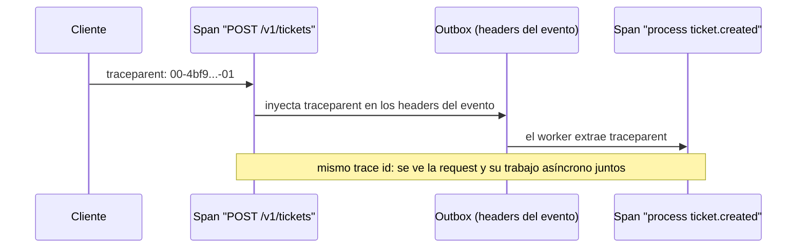

# Observabilidad: RED, saturación, trazas y SLO

## Tres pilares

- **Métricas:** números agregados en el tiempo (requests por segundo, p99). Baratas, sirven para alertar.
- **Trazas:** el recorrido de **una** request por todos los componentes. Sirven para entender por qué esa request fue lenta.
- **Logs:** eventos puntuales con contexto. Aquí son JSON estructurado con `slog`.

## Método RED (por cada ruta)

- **R**ate: `sum by (route) (rate(http_requests_total[1m]))`
- **E**rrors: proporción de `code=~"5.."`
- **D**uration: `histogram_quantile(0.99, sum by (le) (rate(http_request_duration_seconds_bucket[1m])))`

Se complementa con **saturación** (método USE para recursos): profundidad de la cola, antigüedad de la outbox, pool de base en uso, límite AIMD y estado de los breakers.

## Por qué histogramas y no promedios

El promedio esconde la cola. Si el 99 % tarda 2 ms y el 1 % tarda 2 s, el promedio es alrededor de 22 ms, que no describe a nadie. El p99 muestra lo que sufre el 1 % de los clientes, que en un sistema con millones de requests son muchas personas. Los *buckets* incluyen exactamente 0.05, 0.1 y 0.25 s porque son los umbrales de los SLO: "porcentaje bajo 250 ms" es un cociente exacto de contadores.

**Cuidado con la cardinalidad:** los labels son `route` (el patrón, `/v1/tickets/{id}`, no el ID real), `method` y `code`. Si se usara el ID del ticket como label, habría una serie temporal por ticket y Prometheus explotaría.

## Trazas con OpenTelemetry

## SLI, SLO y presupuesto de errores

- **SLI** (indicador): lo que se mide. Ejemplo: proporción de requests sin 5xx.
- **SLO** (objetivo): la meta. Ejemplo: 99.9 % en 30 días.
- **Presupuesto de errores:** 100 % − 99.9 % = 0.1 %. En 30 días son unos 43 minutos de "todo caído". Si sobra presupuesto, se puede desplegar más rápido; si se agotó, se prioriza la estabilidad.

## Alertas por *burn rate*

Alertar con "el error superó el 0.1 % en 5 minutos" genera mucho ruido. Se alerta por **velocidad de consumo** del presupuesto:

| Alerta | Condición | Significa |
|---|---|---|
| Rápida (page) | burn rate > 14.4 en 1 h **y** en 5 min | Se consume el 2 % del presupuesto mensual en 1 hora |
| Lenta (ticket) | burn rate > 6 en 6 h | Problema sostenido, no urgente |

Las dos ventanas (1 h y 5 min) hacen que la alerta se dispare rápido y también se apague rápido cuando el problema se resuelve. Está en `deploy/prometheus/rules/slo.yml`, siguiendo el *SRE Workbook* de Google.

## Grafana o Datadog

El tablero `deploy/grafana/dashboards/crm-ticket-gateway.json` tiene 12 paneles: RED, protección de carga, caché e idempotencia, cola, outbox, breakers, dependencias, triage, workers y saturación. Para Datadog, el agente puede leer el mismo `/metrics` (formato OpenMetrics) y las trazas pueden ir por OTLP sin tocar el código. Por eso conviene instrumentar con estándares abiertos.
