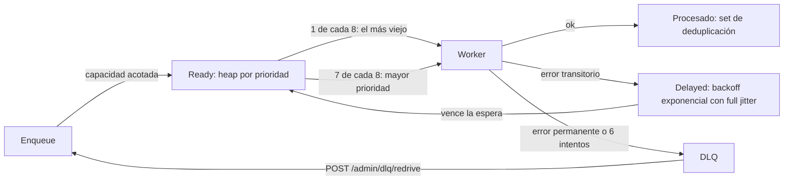

# Transactional outbox y cola de trabajo

## El problema de la doble escritura

Crear un ticket implica dos cosas: **guardarlo** en la base y **avisar** que existe (para clasificarlo y notificar). Son dos sistemas distintos (base y cola). Si se hacen por separado:

- Guardo y después publico, y el proceso muere en el medio: ticket sin evento. Nadie lo clasifica.
- Publico y después guardo, y la transacción falla: evento de un ticket que no existe.

No existe una transacción que abarque la base y la cola (y las transacciones distribuidas, como 2PC, son lentas y frágiles).

## La solución: outbox

El evento se escribe en una tabla `outbox` **en la misma transacción** que el ticket. O se guardan los dos o ninguno. Un proceso aparte, el **relay**, lee la outbox y publica en la cola. Cuando la cola confirma, marca el evento como publicado.

```mermaid
sequenceDiagram
    participant H as Handler HTTP
    participant DB as Base (tickets + outbox)
    participant R as Relay
    participant Q as Cola
    participant W as Worker
    H->>DB: BEGIN; INSERT ticket; INSERT outbox(evento); COMMIT
    H-->>H: responde 201
    H->>R: Kick() (despierta al relay, sin esperar el intervalo)
    R->>DB: lee eventos pendientes en orden
    R->>Q: Enqueue(evento)
    R->>DB: marca publicado
    Q->>W: entrega (prioridad P1..P4)
    W->>W: triage + notificación
```

## La consecuencia: al menos una vez

Si el relay publica y muere antes de marcar, al volver publica de nuevo. La entrega es **al menos una vez** (*at-least-once*), nunca "exactamente una vez". Para que el resultado sea "efectivamente una vez", el **consumidor es idempotente**:

- La cola no reencola un ID que ya está en cola o que se procesó hace poco.
- El triage mira si el ticket ya fue clasificado (`TriagedBy != ""`) antes y dentro de la transacción.

## La cola



- **Prioridad por SLA:** un P1 (urgente) sale antes que un P4. Pero si solo se mirara la prioridad, un P4 podría esperar para siempre en un día de muchos P1 (*starvation*). Por eso 1 de cada 8 veces se toma el mensaje más viejo.
- **Full jitter:** el reintento n espera un tiempo al azar entre 0 y `min(tope, base × 2^n)`. Si todos esperaran exactamente lo mismo, mil mensajes que fallaron juntos reintentarían juntos y volverían a tumbar a la dependencia.
- **DLQ (*dead letter queue*):** lo que no se pudo procesar no se pierde ni bloquea la cola: queda aparte, con el último error, para inspeccionarlo y reprocesarlo.
- **Backpressure:** si la cola está llena, `Enqueue` devuelve `ErrFull`, el relay deja el evento en la outbox y vuelve a intentar. La memoria nunca crece sin límite.

## Lo que encontró la prueba de carga

Con el notificador fallando el 50 % y el breaker abierto, cada intento falla al instante. Con el backoff corto de la prueba (máximo 200 ms), los 6 intentos se agotan en alrededor de un segundo y **4267 a 4268 de 4306 eventos terminaron en la DLQ**. No se perdió ninguno, pero la DLQ se llenó de mensajes que hubieran salido bien unos segundos después. La mejora correcta es **pausar el consumo de ese tipo de mensaje mientras el breaker está abierto**, o no contar como intento un rechazo por breaker abierto. Está anotado en el ADR-0003 como siguiente paso.
