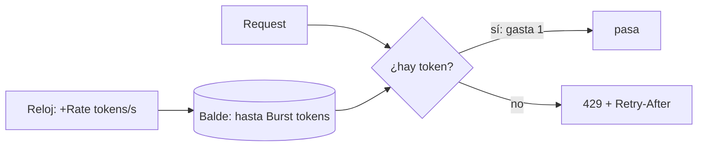
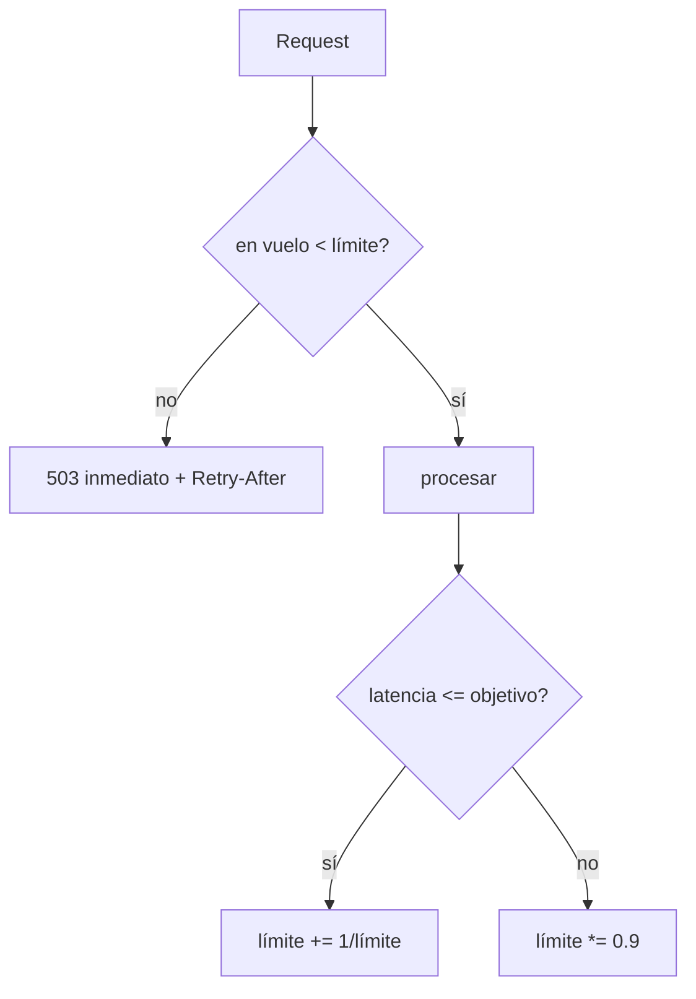

# Protección de carga: rate limit y load shedding

Son dos defensas distintas que se complementan.

| | Rate limit (token bucket) | Load shedding (AIMD) |
|---|---|---|
| Protege de | **Un** cliente que abusa | **Todos** juntos superando la capacidad |
| Mide | Requests por segundo de cada cliente | Requests en vuelo del proceso |
| Responde | 429 + `Retry-After` + `RateLimit-*` | 503 + `Retry-After` |
| Se ajusta solo | No (límite configurado por cliente) | Sí, según la latencia observada |

## Token bucket

Cada cliente tiene un balde de capacidad `Burst`. Se rellena a `Rate` tokens por segundo. Cada request gasta un token; sin tokens, 429.

- Permite ráfagas (hasta `Burst`) y limita el promedio (`Rate`).
- **Relleno perezoso:** no hay una goroutine por cliente. Al llegar la request se calcula `tokens += (ahora − último) × Rate`, con tope en `Burst`.
- **Shards:** el mapa de clientes está dividido en varios mapas con su propio lock para que miles de clientes no compitan por un solo lock.
- **Barrido:** un balde inactivo ya estaría lleno, así que borrarlo no cambia nada. La memoria queda acotada por los clientes activos, no por los históricos.

Alternativas: *leaky bucket* (suaviza más, no permite ráfagas), ventana fija (permite el doble del límite en el borde de dos ventanas) y ventana deslizante (más precisa, más memoria).

**Medido:** con un tenant abusivo a 1500 rps y un límite de 200 rps (ráfaga de 400), el 86.7 % de sus requests recibió 429, y los 50 tenants normales recibieron **0 %** de 429.

## Load shedding adaptativo (AIMD)

**Ley de Little:** en vuelo = tasa de llegada × latencia. Si la base se pone lenta (la latencia sube de 5 ms a 50 ms) con la misma tasa, hay 10 veces más requests en vuelo. Todas compiten por el mismo pool de conexiones, hacen cola y **todas** terminan lentas o con timeout: colapso por congestión.

AIMD (*additive increase, multiplicative decrease*), como el control de congestión de TCP:

- Si una request termina rápido (bajo el objetivo de 100 ms) y el límite se estaba usando: `límite += 1/límite`, es decir, alrededor de +1 cada "vuelta".
- Si termina lenta o con timeout: `límite *= 0.9`, como mucho una vez cada 100 ms para no desplomarse por una sola ráfaga.
- Lo que supera el límite se rechaza **al instante**.

**Por qué conviene:** rechazar rápido al 10 % deja al 90 % con latencia sana. Sin shedding, el 100 % termina lento. Lo verifica `TestLoadSheddingUnderSaturation`.

## Orden en la cadena de middlewares

`cliente → rate limit → shedding → timeout → idempotencia → handler`. Lo más barato y que más rechaza va primero. El rate limit va antes que el shedding para que un cliente abusivo no consuma cupo de concurrencia del resto.
