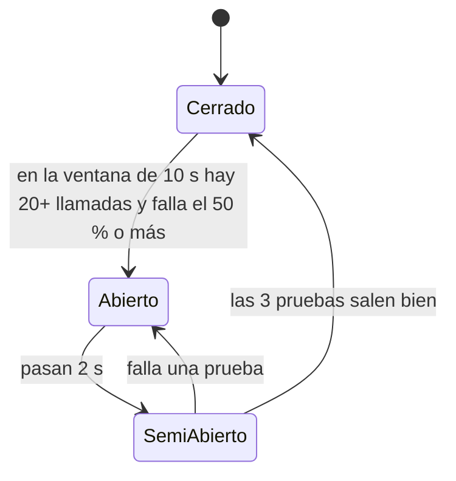
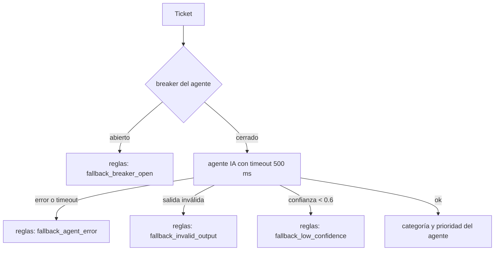

# Resiliencia: circuit breaker, timeout y fallback

## Circuit breaker

Como el disyuntor de una casa: si una dependencia falla mucho, **dejamos de llamarla** un rato. Fallar rápido protege a nuestro servicio (no acumula goroutines esperando) y a la dependencia (le da aire para recuperarse).

- **Ventana deslizante por buckets:** 10 s divididos en 10 buckets de 1 s. Al avanzar el tiempo se descarta el bucket más viejo. Es más estable que contar "las últimas N llamadas".
- **Mínimo de llamadas (20):** con 2 llamadas y 1 falla no hay un 50 % que signifique algo.
- **Semiabierto con 3 pruebas concurrentes como máximo:** para no mandarle de golpe todo el tráfico a una dependencia que recién se recupera.

## Timeout

Toda llamada externa tiene un plazo: 500 ms el agente de IA y 300 ms el notificador. Sin timeout, una dependencia colgada retiene goroutines y conexiones para siempre. El plazo de cada llamada sale del `context.Context`, que se propaga desde la request.

## Fallback a reglas

Las reglas (palabras clave como "fraude", "no llegó", "reembolso") **nunca fallan**: no tienen red ni latencia. La IA mejora la clasificación cuando está, pero el flujo de atención nunca depende de ella.

**Validar la salida del modelo:** aunque el agente responda, se verifica que la categoría y la prioridad sean valores conocidos. Un LLM puede devolver cualquier cosa; nunca se confía en su salida sin validar.

**Prioridad del cliente:** si el cliente mandó una prioridad explícita, el triage no la pisa (`PrioritySource == "client"`).

## Medido

| Escenario | Agente | Fallback |
|---|---|---|
| Dependencias sanas (3 corridas) | 3806 | 500, todos por baja confianza |
| 50 % de fallas (3 corridas) | 34 a 138 | 4168 a 4272; la gran mayoría por breaker abierto (3996 a 4231) |

En las dos situaciones, el 100 % de los tickets quedó clasificado y la latencia de la API fue la misma (p99 alrededor de 4.2 a 4.4 ms).
